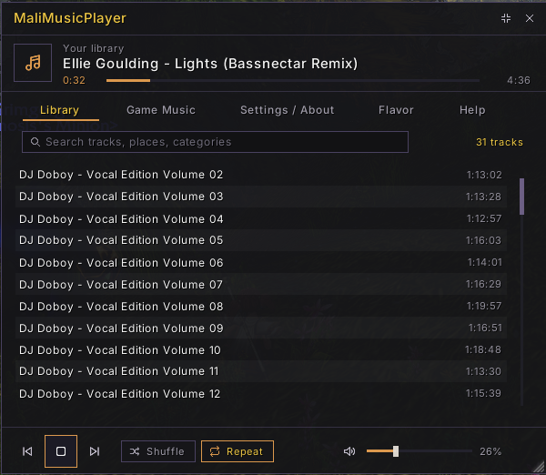
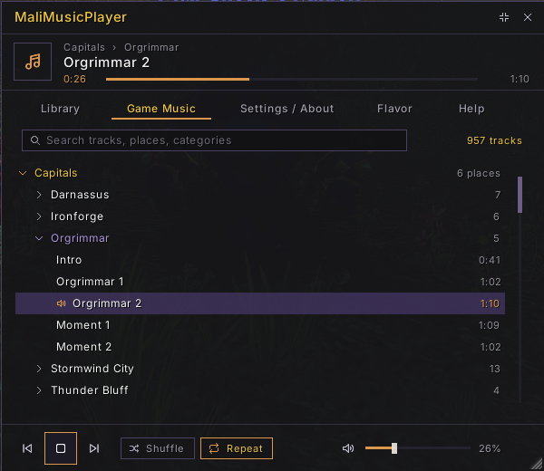

# 🎵 MaliMusicPlayer

**Your music. Your adventures. Your soundtrack.**

Swap WoW's background music for your own MP3 collection, or dive into the game's own soundtrack: capital themes, zone music, dungeon scores and tavern tunes, all sorted and ready to play. 🎧

A full player when you want it, a slim compact bar when you don't, and a look you can make your own.

## 🙋 Who's it for?

Anyone with a music collection they'd love to quest to. And anyone who's ever wanted the Ironforge theme without flying to Ironforge. 🍺

<p align="center"></p>

## ✨ Features

- 💿 **Your own music, built in.** Got MP3s? Drop them in and they play right inside the game. Shuffle, loop a favorite, and no extra app running in the background.
- 🧭 **Minimap button** and `/mmp` to pop it open anytime.
- 🔎 **Instant search.** Type a track, a place or a category and the list follows along.

- 🗺️ **Game Music browser** *(WoW Forever)*. More than 400 of the game's music tracks, organized into Capitals, World Zones, Dungeons & Raids, Taverns & Inns and more. Intros and stingers sit right where they belong.

<p align="center"></p>

- 📻 **Compact player.** A slim bar with the track, time, progress and controls. Drag the corner to size it.

<p align="center"></p>

- 🎨 **Themes.** 12 color presets, from the default warlock Soulstone to Jazz 92 and Rave 99, plus your own saved color profiles, with a live preview as you tweak.

## 🚀 Getting started

1. **Install.** Use the CurseForge app, or copy the `MaliMusicPlayer` folder into `World of Warcraft/<your game version>/Interface/AddOns/`.
2. **Add your MP3s** to `Interface/AddOns/MaliMusic/mp3`. Create the `MaliMusic` and `mp3` folders if they aren't there yet. Subfolders are fine.
3. **Run the updater** from the `MaliMusicPlayer` folder:
   - 🪟 **Windows:** double-click `UpdateLibrary.cmd`
   - 🍎 **macOS:** double-click `UpdateLibrary.command` (first time, right-click it and choose **Open**)
   - 🐧 **Linux:** run `./UpdateLibrary.sh`
4. **Play.** Restart WoW, make sure **MaliMusic** is enabled in the AddOns list, and type `/mmp`. 🎶

Game Music needs no setup at all. It's built for **WoW Forever**; on other versions your MP3 player works as usual.

### 🛡️ Your music is safe from updates

Add-on managers replace the whole `MaliMusicPlayer` folder on every update, so your music and playlist live next door in `MaliMusic`, which updates never touch.

```text
Interface/AddOns/
├── MaliMusicPlayer/   ← the add-on (updates replace this)
└── MaliMusic/         ← yours, never touched by updates
    ├── mp3/           ← your music
    └── Library.lua    ← your playlist
```

Coming from a version before 1.0.1? Those kept music in `MaliMusicPlayer/mp3`, so back it up before updating, then move it into `MaliMusic/mp3` and run the updater.

WoW can't scan folders on its own, so run the updater whenever you add, remove or rename music. The macOS and Linux updaters only need Python 3.8 or newer, and `GenerateLibrary.py` works on Windows too.

## 🎛️ Everyday use

```text
Add MP3s → Run the updater → Restart WoW → Play
```

- New files need a full restart of WoW. If you only changed titles, `/reload` is enough.
- The player uses WoW's music channel, so keep music on with the volume up. If it's off, the speaker button turns red; click it to switch music back on.
- Song titles in Chinese, Japanese or Korean show in WoW's own font, since Inter doesn't include those characters.

### Game Music tips

- Click a category or place to open it. The player remembers what you left open.
- Previous, Next, Shuffle and Repeat stay within the place you're listening to, like a mini playlist.
- Track lengths show `--:--` until a track has played through once.
- Shared themes like Forest, Jungle and Mystery appear under every place that uses them.

### Slash commands

| Command | What it does |
| --- | --- |
| `/mmp` | Open or close the player |
| `/mmp full` · `/mmp compact` | Open the full or compact player |
| `/mmp game` | Open the Game Music tab |
| `/mmp play` · `/mmp stop` · `/mmp next` · `/mmp prev` | Playback controls |
| `/mmpdiag on` · `off` · `status` · `dump` | Audio diagnostics for bug reports |

## ❓ Why no pause or seek?

WoW lets add-ons start and stop sounds, but not pause them or skip to a position. So **Stop** ends a track and **Play** starts it from the top.

## 🛠️ Troubleshooting

**Not in the AddOns list?** Make sure it's in the right game version's `Interface/AddOns` folder and that unzipping didn't add an extra folder. The `.toc` file belongs directly inside `MaliMusicPlayer`.

**Library empty or songs missing?** Check your MP3s are in `MaliMusic/mp3`, run the updater, restart WoW and make sure **MaliMusic** is enabled. The Library tab tells you if it's off or out of date.

**MaliMusic says it's out of date?** Run the updater again. It refreshes the folder after add-on or game updates.

**A song won't play?** It was probably moved or renamed. Run the updater, restart, and double-check your music volume.

**The updater won't run?** Unzip first instead of running it from inside the zip. On macOS or Linux, run `chmod +x UpdateLibrary.command UpdateLibrary.sh` once.

## 🔄 Updating

Update however you like. Your music, playlist and settings carry over. Running the updater once afterward keeps everything in step.

## 🐞 Reporting a problem

Include your WoW and add-on versions, what happened, and any Lua or updater error text. Steps to reproduce help a ton.

## 💜 Credits

ZiRRuSH · Mali Gnosis · Malignosis

**Thanks to:**

- 🧭 **[wago.tools](https://wago.tools)** for its game data exports. The Game Music catalog was built from its ZoneMusic, ZoneIntroMusicTable, SoundKitEntry, AreaTable and WMOAreaTable tables.
- 🔤 **[Inter](https://github.com/rsms/inter)** by The Inter Project Authors, the font behind Mali Style. Its license, the SIL Open Font License 1.1, ships in `media/Inter-OFL.txt`. The bundled copy is converted to TrueType and trimmed to Latin, Greek and Cyrillic.

The add-on icon, the icons in `media/icons` and `Silence.ogg` were made for MaliMusicPlayer and fall under its MIT License.

Game music and the few textures borrowed from the game client are © Blizzard Entertainment. MaliMusicPlayer includes no Blizzard audio; the Game Music tab plays music already installed with your game. MaliMusicPlayer is a fan-made add-on, not affiliated with or endorsed by Blizzard Entertainment.

## 📜 License

MIT License. See `LICENSE.MD` for the full terms. Use it, change it, share it; just keep the copyright and license notice with it.

The license covers MaliMusicPlayer's code, icons and sounds. It doesn't cover your music, the bundled Inter font (SIL OFL 1.1) or the game's music, which is Blizzard's.
