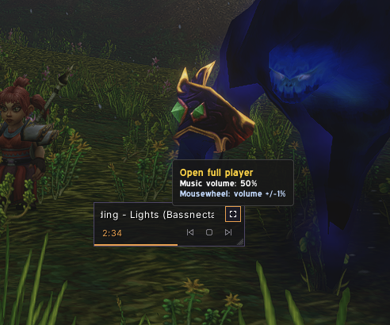

# 🎵 MaliMusicPlayer

**Your music. Your adventures. Your soundtrack.**

MaliMusicPlayer is a **music player** for World of Warcraft. Play your own MP3 collection in place of the normal background soundtrack, or dig into the game's own music: every capital theme, zone track, dungeon score and tavern tune, sorted and ready to play. 🎧

It has a full player window, a compact player that stays out of your way, and a clean look you can recolor to match your UI.


## ✨ What it does

- 💿 **Your MP3s, in game.** Pick a track, shuffle your collection or repeat a favorite while you play.
- 🗺️ **Game Music browser** *(WoW Forever)*. All 435 of the game's music tracks, sorted into a tree: Capitals › Darnassus, World Zones › Mount Hyjal, Dungeons & Raids › Naxxramas, Taverns & Inns and more. Intros and little stingers are filed where they belong.
- 🔎 **Search everything.** Find a track, a place or a whole category as you type.
- 📻 **Compact player.** A slim bar with the track, time, a progress line and your controls. Drag its corner to resize it.
- 🎨 **Make it yours.** Mali Style (flat and dark, the default) or Classic (the standard Blizzard look). Pick your own colors, switch fonts and resize the window, all from the **Flavor** tab.
- 🗺️ **Minimap button** and `/mmp` to open the player any time.


## 🙋 Who is it for?

Players who have their own MP3s and want simple playback controls inside WoW instead of alt-tabbing to a separate music app. And anyone who has ever wanted to hear the Ironforge theme without flying to Ironforge. 🍺



## 🚀 Getting started

1. **Install the add-on.** Copy the `MaliMusicPlayer` folder into `World of Warcraft/<your game version>/Interface/AddOns/` (or install it with the CurseForge app). The `.toc` file should sit directly inside `MaliMusicPlayer`.
2. **Add your MP3s.** Put them in `Interface/AddOns/MaliMusic/mp3`, right next to the add-on (create the `MaliMusic` and `mp3` folders if they aren't there yet; subfolders for your music are fine).
3. **Build your library.** Run the updater for your system from the `MaliMusicPlayer` folder:
   - 🪟 **Windows:** double-click `UpdateLibrary.cmd`
   - 🍎 **macOS:** double-click `UpdateLibrary.command` (if macOS blocks it the first time, right-click it and choose **Open**)
   - 🐧 **Linux:** run `./UpdateLibrary.sh`
4. **Play.** Restart WoW, make sure **MaliMusic** is enabled in the AddOns list, then type `/mmp` or click the minimap icon. 🎶

Tip: run the updater before adding music and it creates the `MaliMusic/mp3` folder and opens it for you.

Game Music needs no setup. It's ready the moment you log in. For now it's built for **WoW Forever**; in other versions of the game the tab shows a note, and your MP3 library works as usual.

### 🛡️ Your music is safe from updates

Add-on managers like the CurseForge app replace the whole `MaliMusicPlayer` folder when they update it. That's why your music and playlist live in their own folder, `MaliMusic`, which updates never touch. It shows up in the AddOns list as **MaliMusic**.

```text
Interface/AddOns/
├── MaliMusicPlayer/   ← the add-on (updated by CurseForge)
└── MaliMusic/         ← yours: made by the updater, never touched by updates
    ├── mp3/           ← your music goes here
    └── Library.lua    ← your track list
```

Upgrading from a version before 1.0.1? Older versions kept music inside `MaliMusicPlayer/mp3`, which add-on managers delete on update, so back that folder up first. If you update by hand, the updater moves that music into `MaliMusic/mp3` for you; otherwise copy it back into `MaliMusic/mp3` once and run the updater.

Run the updater again whenever you add, remove or rename music. WoW can't scan folders itself, so the updater builds the track list for it. The macOS and Linux updaters need Python 3.8 or newer and nothing else; `GenerateLibrary.py` also works on Windows if you prefer it.

Your music stays on your computer. You supply the collection, and MaliMusicPlayer provides the in-game controls.

## 🎛️ Everyday use

```text
Add MP3s → Run the updater → Launch WoW → Play
```

- After adding new audio files, fully restart WoW. `/reload` is enough after the updater changes titles or durations.
- Make sure WoW's **sound and music are on** with the music volume up. The player plays through the game's music channel, so it needs it. When music is off the speaker button turns red; click it to turn music back on.
- Renaming, moving or removing a file breaks its spot in the playlist until you run the updater again.

### Game Music tips

- Click a category or place to open it; the add-on remembers what you left open.
- Previous / Next, Shuffle and Repeat stay inside the place you're listening to, like a little playlist.
- Track lengths show `--:--` until a track has played all the way through once; after that the player remembers them.
- Shared themes (Forest, Jungle, Mystery…) show up under every place that uses them.

### Slash commands

| Command | What it does |
| --- | --- |
| `/mmp` | Open or close the player |
| `/mmp full` · `/mmp compact` | Open the full or compact player |
| `/mmp game` | Open the Game Music tab |
| `/mmp play` · `/mmp stop` · `/mmp next` · `/mmp prev` | Playback controls |
| `/mmpdiag on` · `off` · `status` · `dump` | Audio diagnostics for bug reports |

## ❓ Why no pause or seek?

MaliMusicPlayer works as a replacement soundtrack: it quiets WoW's background music and plays your track through the music channel. WoW lets add-ons start and stop sounds, but not pause them or jump to a position, so **Stop** ends a track and **Play** starts it from the top. That's a limit of what WoW gives add-ons, not a missing feature.

## 🛠️ Troubleshooting

**The add-on isn't in the AddOns list.** Check it's in the right game version's `Interface/AddOns` folder, and that extracting didn't add an extra folder level. The `.toc` must be directly inside `MaliMusicPlayer`.

**The library is empty or songs are missing.** Check your MP3s are in `MaliMusic/mp3`, run the updater, let it finish, and fully restart WoW. Make sure **MaliMusic** is enabled in the AddOns list; the Library tab tells you if it's off or out of date.

**"MaliMusic" says it's out of date.** Run the updater again after updating the add-on or the game; it refreshes the folder's version info.

**A song is listed but won't play.** The file may have been moved or renamed since the library was built. Run the updater again and restart. Also check WoW's sound, music and volume settings.

**The updater fails.** Extract the zip first; don't run the updater from inside it. On macOS or Linux, if the launcher won't start, run `chmod +x UpdateLibrary.command UpdateLibrary.sh`. When reporting a problem, include the error text it shows.

## 🔄 Updating

Update however you like; your music and playlist in `MaliMusic` are never touched. After an update, run the updater once so your music folder stays in step with the add-on. Your settings are saved by WoW and carry over.

## 🐞 Reporting a problem

Please include your WoW version and add-on version, what you were doing, what you expected and what happened, and any Lua error or updater error text. Steps to reproduce it help a lot. No need to send your music collection.

## 💜 Credits

ZiRRuSH · Mali Gnosis · Malignosis

**Thanks to:**

- 🧭 **[wago.tools](https://wago.tools)** for its game data exports. The Game Music catalog was built from its ZoneMusic, ZoneIntroMusicTable, SoundKitEntry, AreaTable and WMOAreaTable tables.
- 🔤 **[Inter](https://github.com/rsms/inter)** by The Inter Project Authors, the font used by Mali Style. MaliMusicPlayer ships with Inter's license, the SIL Open Font License 1.1, in `media/Inter-OFL.txt`. The bundled copy is converted to TrueType and trimmed to Latin, Greek and Cyrillic.

The add-on icon (`media/icon.tga`), the icons in `media/icons` and `Silence.ogg` were made for MaliMusicPlayer and are covered by its MIT License.

Game music and the few textures borrowed from the game client are © Blizzard Entertainment. MaliMusicPlayer contains no Blizzard audio; the Game Music tab plays music already installed with your game. MaliMusicPlayer is a fan-made add-on and is not affiliated with or endorsed by Blizzard Entertainment.

## 📜 License

Released under the MIT License. See `LICENSE.MD` for the full terms.

Use it, change it, share it. Keep the copyright and license notice with copies or substantial portions of the software.

The MIT License covers MaliMusicPlayer's code, icons and sounds. It doesn't cover the music you add, the bundled Inter font (SIL Open Font License 1.1, see `media/Inter-OFL.txt`), or game music, which remains Blizzard's.
